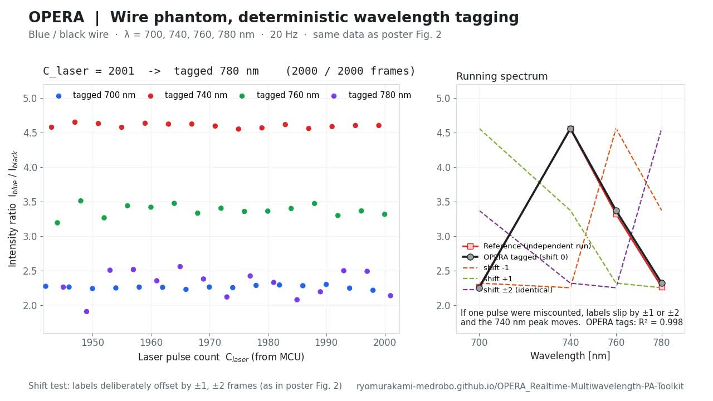
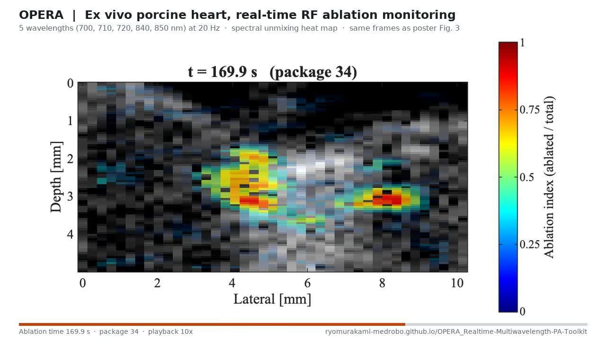

# OPERA: Real-time Multi-wavelength PA Toolkit

**OPERA** (OPOTEK–vERAsonics Architecture) is an open-source framework for real-time multi-spectral photoacoustic imaging (RT-mPAI).
An external microcontroller counts every laser pulse in hardware, so the wavelength tag on each RF frame does not depend on host OS timing (validated so far on a phantom; see the paper). Frames stream over TCP to a separate workstation and are handed to your own processing through shared memory.

**Project page:** https://ryomurakami-medrobo.github.io/OPERA_Realtime-Multiwavelength-PA-Toolkit/ · **Current release:** v0.2.0 (2026-10-18) · [Changelog](CHANGELOG.md)

| Wire phantom: wavelength tagging (poster Fig. 2) | Ex vivo porcine heart: RF ablation monitoring (poster Fig. 3) |
|---|---|
| [](docs/media/opera_phantom_tagging.mp4) | [](docs/media/opera_heart_ablation.mp4) |
| 2,000 frames at 20 Hz, 4 wavelengths. Tagged spectrum vs. reference R² = 0.998. | 5 wavelengths at 20 Hz, 49 packages over 250 s, playback 10×. |

Both videos are rebuilt by [`tools/media/build_poster_videos.py`](tools/media/build_poster_videos.py); source and output hashes are recorded in [`docs/media/manifest.json`](docs/media/manifest.json).

## About this repository

This repository is a public-safe minimal reference for a real-time multi-wavelength workflow.
The repository direction is general-purpose real-time workflow tooling.
As an initial example, the first reference path is described around an OPOTEK-laser and Verasonics-host setup.

It mirrors the current lab architecture with three systems:
1. Arduino trigger monitor
2. Verasonics host script
3. TCP receiver + two MATLAB instances (server and client)

The purpose is to show required implementation elements and interfaces. The public draft runs in offline demo mode by default, and can be expanded with local hardware and a licensed Verasonics SDK.

**Related Publications:**
1. Democratization of Real-time Multi-Spectral Photoacoustic Imaging: Open-Sourced System Architecture for OPOTEK Phocus & Verasonics Vantage Combination,
   Ryo Murakami, Yichuan Tang, Haichong K. Zhang  
   arXiv:2604.15255 \[cs.AR\] (v1, 16 Apr 2026)  
   DOI: https://doi.org/10.48550/arXiv.2604.15255  

## Scope

Included:
- Minimal MATLAB and Arduino scaffolds for end-to-end data flow
- Configuration templates for network, serial, and DAT memory-mapped backend settings
- Public attribution and licensing package
- Tiny mock dataset for non-hardware dry-run documentation

Not included:
- Verasonics SDK redistribution
- Probe-specific production parameter sets
- Fully validated hardware timing and safety guarantees

<p align="center">
  
</p>

## Repository Layout

```text
OPERA_Realtime-Multiwavelength-PA-Toolkit/
  arduino/trigger_monitor_minimal/
  verasonics/
  server/
  client/
  shared_memory/
  config/
  sample_data/
  docs/            project page (index.html), media/, design notes
  tools/media/     scripts that build the page videos and images
  notices/
  LICENSE
  CREDITS.md
  CHANGELOG.md
```

## Quick Start (Structure Verification)

1. From the repository root in MATLAB, run `setup_paths` once to add all toolkit folders to the current session path.
2. Edit configuration templates in `config/`.
3. Start MATLAB server script first:
   - `server/run_tcp_server.m`
   - This creates the temporary backend file under the system temp folder.
4. Start MATLAB client script in another MATLAB instance:
   - `client/run_processing_client.m`
   - The client drains all currently available packages and exits after a short idle grace period.
5. Prepare Verasonics-side adaptation:
   - `verasonics/run_verasonics_host_template.m`
6. Upload Arduino sketch:
   - `arduino/trigger_monitor_minimal/trigger_monitor_minimal.ino`

Default behavior in this draft:
- Arduino communication is disabled until `cfg.hardware.enable_arduino` is set to `true`.
- The Verasonics template falls back to offline demo mode if no TCP server is available.
- Shared state is stored in a temporary DAT file named `shared_image_data_public.dat`.

## Interface Contract (Minimal)

- Verasonics host sends frame packets to TCP server:
  - Payload: int16 RF image (`image_width x image_height`) + metadata
  - Metadata: `success_count`, timestamp, sequence counters
- Verasonics host also talks to Arduino over serial:
   - `RESET` initializes the counter state
   - `R` returns the latest `success_count`
   - The returned counter is included in the TCP packet metadata
- Server aggregates into package tensor and writes to the DAT shared-memory file.
- Client polls the same DAT file, drains available packages, and marks them as processed.
- Arduino responds to serial commands:
  - `R` -> returns current success count
  - `RESET` -> resets internal counters

## Current Release Decisions

- Energy compensation is intentionally disabled in this public draft.
- Verasonics probe-specific values are masked with TODO placeholders.
- Network and hardware values are template-driven; no fixed local IP/COM is required.
- Arduino is off by default so the public demo can run without hardware.
- Shared-memory handoff uses a fixed-size memmapfile DAT layout, not a MAT file.
- The client exits after the queue stays empty for a short grace period, so the public demo does not run forever.

## Important Disclaimer

- Performance optimization for high-throughput real-time operation is not fully implemented in this sample code.
- Correct execution in every environment is not guaranteed.
- This repository is a public minimal reference and should be validated by users on their own hardware and software stack.

## Credits and Legal

- Authors: Ryo Murakami, Yichuan Tang, Shun Katayose, Haichong Kai Zhang
- Institution: Medical FUSION Laboratory, Worcester Polytechnic Institute
- License: MIT (see `LICENSE`)
- Verasonics notice: see `notices/NOTICE.md`

## Citation

If you use this repository structure or adapt this workflow in your research, please cite the associated archive paper.

Note:
- The current archive paper is focused on an OPOTEK + Verasonics-specific implementation.
- This repository is intentionally organized to remain broader than that single hardware combination.

- Citation guidance and template: [docs/CITATION.md](docs/CITATION.md)

This repository intentionally keeps citation metadata in one place so it can be updated when archive information changes.

## Vision

This repository is planned to evolve from a minimal reference into a broader open-source real-time ultrasound and photoacoustic utility repository:

- support for multiple probe configurations
- reusable real-time pipeline utilities beyond a single device setup
- broader laser-device interoperability over time, beyond the initial OPOTEK-focused reference path

## Start Here

If you want the smallest possible overview first, read [docs/MINIMAL_IDEA.md](docs/MINIMAL_IDEA.md).

## Next Implementation Steps

1. Replace TODO sections in Verasonics template with your licensed SDK setup.
2. Set `cfg.hardware.enable_arduino = true` and fill in the COM port when running with hardware.
3. Replace placeholder processing function in client with your beamforming and decomposition pipeline.
4. Add hardware validation tests (serial timing, network latency, synchronization).
